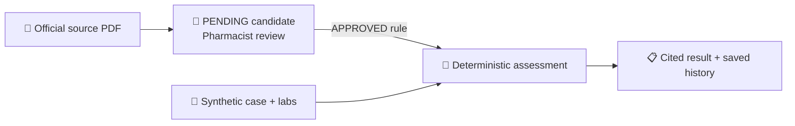

# 🩺 RenalSafe

### Renal dose assessment, source evidence, and human review

A local academic clinical decision support application built with **Go**, **React / TypeScript**, and **PostgreSQL + pgvector**.

[](core/)
[](web/)
[](web/)
[](docs/architecture.md#database)
[](compose.yaml)

[🚀 Installation](#installation) · [🔑 First sign-in](#first-sign-in) · [📚 Documentation](docs/README.md) · [🛠️ Development](docs/development.md)

> 🧪 **Synthetic patients only.** This is an academic prototype, without clinically approved dosing rules. Cases without an applicable approved rule return **manual review required**. Model suggestions always require human review.

<a id="what-you-can-do"></a>

## ✨ What you can do

| Workflow | Features |
|---|---|
| 🧮 **Assess renal function** | Cockcroft–Gault and CKD-EPI 2021, explicit units, uncertainty checks, and cited results |
| 👤 **Manage synthetic cases** | Patient profiles, dated laboratory observations, shared access, and saved assessments |
| 🔎 **Inspect source evidence** | Versioned SmPC / ChPL PDFs, quotations, page references, and evidence search |
| 📝 **Prepare and review rules** | Manual candidates or optional OpenAI / NVIDIA suggestions, saved as PENDING for pharmacist review |
| 🔁 **Reproduce results** | Historical replay, JSON / printable reports, and an immutable application audit trail |

## 🔄 From source to assessment



Manual preparation and optional AI extraction both feed the PENDING review workflow. The decision engine uses eligible approved rules; missing rules produce a manual-review result.

<a id="installation"></a>

## 🚀 Installation

You need **Git**, **Docker with Docker Compose**, and **Python 3**. Start Docker before continuing. Docker builds the frontend and backend and includes Poppler; a host Go, Node, or model installation is unnecessary for this route.

### 1. 📥 Get the code

```sh
git clone https://github.com/timGalk/renalsafe.git
cd renalsafe
```

Already have a checkout? Run the remaining commands from its root directory.

### 2. ⚙️ Create local configuration

```sh
python3 scripts/bootstrap-local.py
```

This creates `.env` and private credentials under `.local/`. Run it once on a fresh checkout. It refuses to overwrite existing configuration; keep those files when upgrading.

For optional AI providers and demo sign-in, copy the settings you need from [.env.example](.env.example) into the generated `.env`.

### 3. ▶️ Build and start

```sh
docker compose up -d --build
```

The first build downloads dependencies and container images. The application applies database migrations automatically.

Open **[RenalSafe → http://127.0.0.1:8080](http://127.0.0.1:8080)** and complete first sign-in below.

<a id="first-sign-in"></a>

## 🔑 First sign-in

### Create your administrator account

With the application running:

```sh
python3 scripts/setup-accounts.py workspace-admin --role admin \
  --output .local/workspace-admin-activation.json
```

1. Open `.local/workspace-admin-activation.json` locally to read the username and activation secret.
2. Open **[Activate or reset an account](http://127.0.0.1:8080/activate)**, enter those details, and choose a password of at least 15 characters.
3. **[Sign in](http://127.0.0.1:8080/login)**, then use **Staff accounts** to create physician and pharmacist accounts.

Activation secrets expire after 30 minutes and work once. Keep the activation file private. See [account setup and recovery](docs/accounts.md) if activation expires or the account already exists.

<details>
<summary><strong>🎮 Just exploring? Enable demo sign-in</strong></summary>

For an isolated local demonstration with synthetic data:

```sh
RENALSAFE_DEMO_LOGIN=true docker compose up -d --build
```

The login page offers quick sign-in as physician, pharmacist, or administrator. Anyone with access to this demo can use these roles, including administrator privileges.

To turn it off, run `docker compose up -d` without the variable. If you saved it in `.env`, remove it or set it to `false` first. Restarting with demo sign-in disabled revokes demo sessions; synthetic demo records remain.

</details>

<a id="try-the-workspace"></a>

## 🧭 Try the workspace

- 🩺 **Physician:** open **Patients**, create a fictional case, add a creatinine observation, and start an assessment. Use **Saved results** to reopen, replay, or export it.
- 💊 **Pharmacist:** inspect source documents, prepare PENDING candidates, and review complete source evidence before any approval.
- 🛡️ **Administrator:** manage staff accounts and inspect system status and audit history.

For a prepared example, run `python3 scripts/demo-two-drugs.py` and follow the [two-drug demonstration](docs/demo-guide.md). It imports the pinned sources and saves synthetic assessments without creating or approving clinical rules.

The isolated **[fictional teaching demo](http://127.0.0.1:8080/demo.html)** also shows engine behavior without signing in.

<a id="everyday-commands"></a>

## ⌨️ Everyday commands

| Task | Command |
|---|---|
| Check services | `docker compose ps` |
| Read application logs | `docker compose logs --tail=100 core` |
| Stop | `docker compose stop` |
| Resume | `docker compose up -d` |
| Rebuild after code changes | `docker compose up -d --build` |

Data survives container restarts in the database volume. Keep `.env` and `.local/`, and follow the [backup and recovery guide](docs/release-recovery.md) before upgrading or restoring data. Removing the database volume deletes saved history.

<a id="optional-ai-extraction"></a>

## 🤖 Optional AI extraction

The application works without an API key. To enable online extraction, add your key to the ignored local `.env` file:

```dotenv
OPENAI_API_KEY=your-api-key
```

Rebuild with `docker compose up -d --build`, then open **Documents → Extract rule suggestions** as a pharmacist or administrator. The default OpenAI model is `gpt-5.4-mini`; NVIDIA configuration and model overrides are in the [extraction guide](docs/online-extraction-guide.md).

Only selected public source content and product context go to the configured provider. Patient records are excluded. Suggestions become PENDING candidates only through explicit saves; pharmacist approval stays separate.

<a id="repository-map"></a>

## 🗂️ Repository map

```text
RenalSafe/
├── core/          Go decision engine, API, database migrations, and CLI
├── web/           React / TypeScript workspace
├── api/           Generated OpenAPI contract
├── data/          Pinned source documents and synthetic fixtures
├── scripts/       Setup, demonstrations, checks, and recovery tools
├── docs/          User, developer, and evaluation guides
├── experiments/   Standalone model-comparison notebooks and source
├── .planning/     Roadmap, phase records, and historical research
└── compose.yaml   Local application and database services
```

Local credentials, backups, generated reports, dependencies, and browser builds are ignored by Git. The [architecture guide](docs/architecture.md) explains the database and component boundaries.

<a id="learn-more"></a>

## 📚 Learn more

| Guide | Contents |
|---|---|
| [Documentation index](docs/README.md) | All current guides |
| [Development](docs/development.md) | Host builds, tests, API regeneration, embeddings, and offline CLI |
| [Workspace](docs/final-workspace.md) | Pages, permissions, and role workflows |
| [Clinical boundaries](docs/clinical-review.md) | Review requirements, calculator scope, and limitations |
| [Release and recovery](docs/release-recovery.md) | Installation, migrations, backups, and recovery |
| [Evidence and remaining work](docs/release-evidence.md) | Executed checks and independent validation still needed |
| [Paired model experiment](experiments/model-comparison-v2/README.md) | ChPL pilot, annotation, and comparison protocol |

Clinical validation, independently labeled model evaluation, and harder PDF / OCR fidelity remain open. See the [roadmap](.planning/ROADMAP.md) for project progress.
