# AI-assisted rule extraction: research and proposed implementation

Research date: 2026-11-05. Status: planned local extraction pipeline, not an implemented extractor or selected clinical model. User confirmed local inference on 2026-11-05. The first target is this computer; usable GPU memory/runtime remains a preflight check. Design contract: ../.planning/phases/04-ingestion-review/04-AI-SPEC.md.

## Recommendation and evidence

Build one source-grounded extraction pipeline with interchangeable model adapters. Start the local capability prototype with quantized Qwen3.5-4B through Ollama; compare it with MedGemma 1.5 4B on the same reviewed source cases before selecting a clinical extraction default. Start with prompting and validation; postpone fine-tuning until measured errors and an independently labeled training/evaluation split justify it. Run one model per extraction job; a two-model agreement is not a substitute for independent review.

| Candidate | Published basis for testing it | Limits relevant to RenalSafe |
|---|---|---|
| `Qwen/Qwen3.5-4B` | Official multimodal model card describes multilingual capabilities and document-understanding evaluations; Apache 2.0 license | General-purpose model; Polish renal-rule accuracy is unmeasured. Small-model shortlist, not a proven winner |
| `google/medgemma-1.5-4b-it` | Google documents medical text/image comprehension and structured extraction from medical documents | Published document examples focus on lab reports, not ChPL dosing tables. Medical specialization does not establish correct dose extraction. Access and Health AI Developer Foundations terms must be satisfied by the operator |
| `Qwen/Qwen3.5-9B` | Same family, larger comparison option | Include only if the actual inference host has sufficient memory and acceptable latency. No assumed fit on the current laptop |

Research sources:

- [Official Qwen3.5-4B model card](https://huggingface.co/Qwen/Qwen3.5-4B): capabilities, license, serving examples and generation settings.
- [Official Qwen3.5-9B model card](https://huggingface.co/Qwen/Qwen3.5-9B): optional larger comparison.
- [Google MedGemma model card](https://developers.google.com/health-ai-developer-foundations/medgemma/model-card): model identifier, document tasks, local Transformers examples, limitations and required downstream validation.
- [Google model repository](https://huggingface.co/google/medgemma-1.5-4b-it): distribution and access/terms information.
- [Ollama structured outputs](https://docs.ollama.com/capabilities/structured-outputs): JSON Schema in `format`, Pydantic validation and image inputs. Runtime support for the exact selected model/artifact still needs a smoke test.
- [Ollama Qwen3.5-4B distribution](https://ollama.com/library/qwen3.5:4b): local quantized artifact candidate. Download size is not runtime memory usage.
- [Ollama chat API](https://docs.ollama.com/api/chat) and [model inventory](https://docs.ollama.com/api/tags): request format, completion status, supported thinking configuration and model digest/quantization metadata.
- [vLLM structured outputs](https://docs.vllm.ai/en/latest/features/structured_outputs/): schema-constrained serving alternative for an appropriate GPU host.
- [Pydantic JSON validation](https://docs.pydantic.dev/latest/concepts/json/): parse and validate returned JSON independently of the provider.
- [EMA section 4.2 training material](https://www.ema.europa.eu/en/documents/presentation/presentation-section-42-posology-method-administration_en.pdf): dose instructions and renal cut-offs must retain their context.

Recommendation is an engineering inference from these sources and this repository, not a published head-to-head comparison. Neither model has been run here for this task. GPU enumeration reports an NVIDIA RTX 4050 Laptop GPU and approximately 30 GiB system RAM; `nvidia-smi` is unavailable in this environment and an NVML initialization attempt failed, so usable VRAM, GPU runtime access and achievable speed are unverified. No model or package has been installed by this planning work.

## Proposed workflow

```mermaid
flowchart LR
    A[Versioned official PDF] --> B[Scoped text, tables and page context]
    B --> C[Extraction job]
    C --> D[Qwen or MedGemma adapter]
    D --> E[Validated suggestions and unresolved conditions]
    E --> F[Source and suggestion review]
    F --> G[Explicit save as PENDING rule]
    G --> H[Existing pharmacist approval]
    H --> I[Deterministic Go assessment engine]
```

Poppler remains useful for born-digital PDFs: extract immutable text with physical page and byte provenance. Models interpret supplied passages; they do not replace source storage. Supply table headers, footnotes and explicitly referenced dosing context together. Do not rely on the highest-ranked retrieval fragment alone: a missing footnote or referenced baseline dose can change interpretation. Expand bounded context or abstain when references cannot be resolved within the exact product scope.

For the first increment, process text-bearing PDFs and explicitly flag broken layout or missing text. A later vision experiment may include rendered page crops with full headers/footnotes and original-page coordinates. Model-transcribed or OCR text must never be presented as an exact quotation from the existing stored extraction unless a separate, versioned transcription/provenance flow is implemented. Do not silently replace stored text or reuse existing approval after re-extraction.

## Contract and boundaries

1. A pharmacist or administrator selects an active document and source passages and requests extraction. Only source material and product context go to the worker; no patient history, credentials or assessment inputs are included.
2. Go creates a durable asynchronous extraction job. A Python worker obtains a bounded job payload through a private authenticated interface and calls the configured model. The worker has no clinical approval privilege and no direct write access to rules, assessments or audit tables.
3. Model output is a strict suggestion envelope: supported findings, abstentions and unresolved conditions. Each finding includes renal metric as stated, units, exact boundary operators, dose wording, optional structured dose/interval facts, population/indication/route conditions, and evidence for each field. Unknown values remain unknown.
4. Go validates returned shape, size, source identity and evidence spans against pinned source bytes. The server owns source IDs, versions, hashes, physical pages and provenance. Numeric presence is a necessary check, not semantic proof. Repeated quotation matches require explicit evidence disambiguation.
5. Suggestions are stored separately from `renal_rules`. The review screen shows original PDF/passage, extracted fields, evidence and unresolved items. A user can correct/reject suggestions. Explicit save calls the existing candidate validation path and creates only a PENDING rule; pharmacist approval remains a separate operation.
6. Approval and clinical eligibility never depend on a model confidence score. An unavailable model cannot stop existing assessment/replay/manual-candidate workflows.

The intermediate schema must be richer than today's executable `Rule`. It must preserve relative doses, loading versus maintenance instructions, daily caps, mg/kg or body-surface dosing, dialysis timing, monitoring requirements, dependencies and source conflicts. Such findings remain non-executable when the Go rule contract cannot express them. In particular:

- “Half the usual dose” is not converted into a fixed milligram dose without explicit, supported baseline context and an implemented dependency representation.
- A prescribed fixed regimen is not automatically equivalent to a maximum-dose/minimum-interval limit. Do not populate current `RegimenLimit` unless that interpretation is source-supported and reviewer-confirmed.
- CrCl is not relabeled Cockcroft–Gault, or GFR CKD-EPI 2021, merely to fit the current enum. Unspecified estimation method remains unresolved until qualified review establishes applicability.
- Boundary ambiguity (`<`, `≤`, ranges with unstated inclusivity), overlapping instructions and conflicting source sections trigger review rather than guessed executable values.

## Implementation increments and acceptance

| Increment | Deliverables | Acceptance |
|---|---|---|
| 1. Contract and reference cases | Suggestion/job schemas, field evidence, supported mapping specification, independently reviewed initial cases | Unsupported semantics cannot be lost during conversion; no real candidate automatically activated |
| 2. Worker and adapters | Durable job lifecycle, local provider abstraction, strict parsing, bounded input/output, deadlines, failure reporting, model manifest | Fake-provider tests cover malformed JSON, invented quotes, changed model, truncation, cancellation and retries; selected real runtime passes a separate capability smoke test |
| 3. Review integration | Request/status UI, source/evidence comparison, corrections/rejection, explicit PENDING save, provenance | Duplicate save/retry is idempotent; stale/superseded sources and changed permissions block save; worker cannot approve |
| 4. Model comparison | Frozen prompts, model/artifact revisions, quantization/runtime settings, reviewed development/held-out cases, reports | Report field-level and whole-rule correctness, unsupported statements, missed conditions, abstentions, human correction time, extraction latency and peak memory |
| 5. Harder PDFs/vision | Separate text-versus-page-image experiment and evidence/transcription design | Original-page provenance preserved; scanned/malformed tables cannot silently enter the existing exact-text rule path |

Start with 10–20 independently reviewed extraction examples across English and Polish sources, including the already acquired Meronem/Ceftazidime documents, negative cases and difficult table conditions. Report exact product coverage; this small set is not the original five-product approval milestone or the approximately 20-product/200-case thesis evaluation. Split by document/product rather than randomly by table rows to avoid leaking near-duplicates into held-out evaluation. If that is impossible with the initial corpus, label results a development pilot and defer held-out claims. Keep raw model output, corrected output and reviewer labels distinct.

Synthetic examples can immediately verify software boundaries; they cannot establish clinical extraction quality. Independent clinical labels and current source applicability remain required for model selection claims. Existing Phase 4 review checkpoint is retained; engineering contracts and fake-provider plumbing can proceed while labels are being prepared.

## Local runtime decision and remaining checks

- Deployment location: local, confirmed by user. Model calls must target an explicitly configured local runtime; inference must not fall back to a hosted API. Model/package downloads during setup are distinct from sending document content for inference.
- First runtime candidate: Ollama with `qwen3.5:4b`, resolving and recording the installed digest, quantization and capabilities before a run. Keep the host service bound to loopback; container networking must not require a public model port. Exact model/schema compatibility and usable memory remain capability-spike checks.
- MedGemma comparison: Google's documented local Transformers path with independent Pydantic parsing. Do not assume MedGemma is available or identical under an arbitrary Ollama tag. vLLM remains an alternative only if local hardware/runtime testing justifies it.
- Select exact package versions, container digests, model revisions and any quantized-artifact provenance during the capability spike; mutable tags alone do not identify an experiment. Model-specific decoding settings must be explicit and benchmarked; temperature zero is not a guarantee of repeatability or accuracy.
- No LangChain/LangGraph requirement for the first linear pipeline. Use a small Python worker and explicit provider interfaces; keep jobs and authority in Go/PostgreSQL. Reconsider a larger framework only if concrete branching or orchestration requirements emerge.
- Preserve current audit as authoritative. Store run hashes/versions/timings and reviewer edit history; keep bulky raw artifacts in controlled storage with explicit retention. No external tracing export is required. Optional self-hosted tracing is a later addition.
- Suggested experimental runtime limits: one concurrent model job initially; bounded section bundles and explicit output limit, measured on the chosen host. Final memory, deadline and token budgets must follow the capability spike. Over-budget input must abstain or split with preserved table context, never silently truncate.

Phase 9 remains the next release-engineering action. This proposal expands Phase 4's remaining extraction work and contributes extraction experiments to Phase 5; it does not mark either phase complete or change clinical eligibility.
