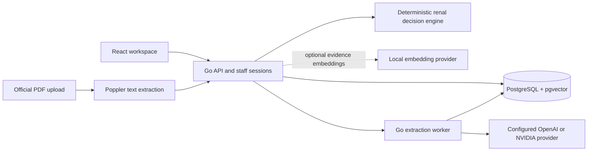

# Current architecture and repository layout

The application serves the React workspace and Go API from one origin. PostgreSQL 18 with pgvector stores clinical source material, reviewed rules, staff accounts, synthetic cases and assessment/audit history. Docker Compose runs the database and application; Node is needed only to build the frontend. The optional local embedding service searches evidence and does not create rules or choose doses. An in-process Go extraction worker calls the configured OpenAI or NVIDIA provider and stores cited suggestions for explicit PENDING candidate saves. Models cannot approve rules or change assessments.

## Source layout

| Path | Responsibility |
|---|---|
| `core/cmd/` | API server, offline CLI and OpenAPI generator |
| `core/internal/` | Decision/calculator, source/rule validation, sessions, persistence and HTTP API |
| `core/internal/store/migrations/` | Immutable content-hashed migrations 001–005 |
| `core/internal/httpapi/web/demo.*` | Supported isolated teaching UI linked from React; not the retired browser client |
| `web/` | React/TypeScript sources, generated API types and locked build dependencies |
| `api/openapi.json` | Generated checked-in API contract |
| `data/` | Pinned source PDFs/text/manifests and synthetic request/evaluation fixtures |
| `scripts/` | Bootstrap, account setup, demonstrations, evaluations, browser tests and release/recovery tools |
| `docs/` | Current guides, design rationale and thesis-facing release evidence |
| `.planning/` | Roadmap, requirements, phase contracts/summaries and dated history |
| `.local/`, `outputs/`, `work/` | Ignored private configuration/backups, generated reports and local scratch work |

`web/node_modules/` and `core/internal/httpapi/web/dist/` are generated and ignored. Build React assets before host Go checks; Docker handles this ordering. Generated OpenAPI/client types are intentionally tracked so contract drift is reviewable.

## Database

All sixteen public tables are created by the checked-in migrations in the Docker database. The named `renalsafe_database` volume persists across container restarts. It is not a substitute for a verified backup.

| Area | Tables |
|---|---|
| Authentication | `app_users`, `auth_sessions`, `login_limits` |
| Synthetic case history | `synthetic_patients`, `patient_access`, `renal_observations`, `patient_assessments` |
| Saved results | `assessments` |
| Knowledge/source storage | `documents`, `chunks`, `renal_rules`, `knowledge_revision` |
| Extraction | `extraction_jobs`, `extraction_candidates` |
| Integrity/versioning | `audit_events`, `schema_migrations` |

Source PDFs and extracted text are stored with versions/hashes; passages retain physical pages/byte spans. Only eligible approved rules can be matched. Patient assessment inputs/results and knowledge snapshots remain immutable; lab corrections append replacements. Application writes commit with audit. Database-owner access can bypass application protections; see [release operations](release-recovery.md) for actual privilege/recovery limits.

The standalone Go CLI and `/demo.html` deliberately work without the database. Teaching rules are explicitly fictional fixtures, not clinically approved source rules. Staff service keys are still used by setup/evaluation/recovery tools; removing them would break supported workflows. Browser users sign in with passwords and server-side cookie sessions.

See [workspace routes](final-workspace.md), [account/session policy](accounts.md), [patient permissions](patient-history.md) and [API contract](../api/openapi.json). [ADR-002](ADR-002-main-system.md) preserves the earlier decision rationale; [online extraction guide](online-extraction-guide.md) documents the implemented provider, job and review workflow.

## Audit and replay boundaries

Journal locking is fail closed: competing writers or a leftover lock after a crash stop output. Inspect the journal before manual lock recovery. Hash chains detect corruption and ordinary edits; complete rewriting or truncating whole events needs external anchoring to detect. The API adds transactional persistence and role-bound review; cryptographic human signatures, external anchoring and retention remain separate work. Local snapshot backup and restore verification are implemented; see [release and recovery](release-recovery.md).
